# NYC in Marvel Universe

An unofficial, fan-made, interactive 3D portrait of a Marvel-flavoured New York. Fly over a Manhattan built from the city's real
building footprints, restyle the light and weather, walk down to street level past the Sanctum Sanctorum, and export
wallpapers up to 8K. **The city itself is the star: there are no character figures** (they were removed in Phase 2).

**Live demo: <https://nyc.si1v3r.xyz>** (desktop browser with WebGL2 recommended)

> **Background.** This is a weekend experiment, not a serious engineering project. I built it to see what Claude's
> new model, Fable 5.2, can do, both technically and in terms of visual taste. All of the code was written by the model,
> and I mostly just described what I wanted and looked at the results. Don't expect carefully designed architecture,
> optimisation or deep technical ideas here. It's a toy made for fun, shared as-is and not actively maintained.

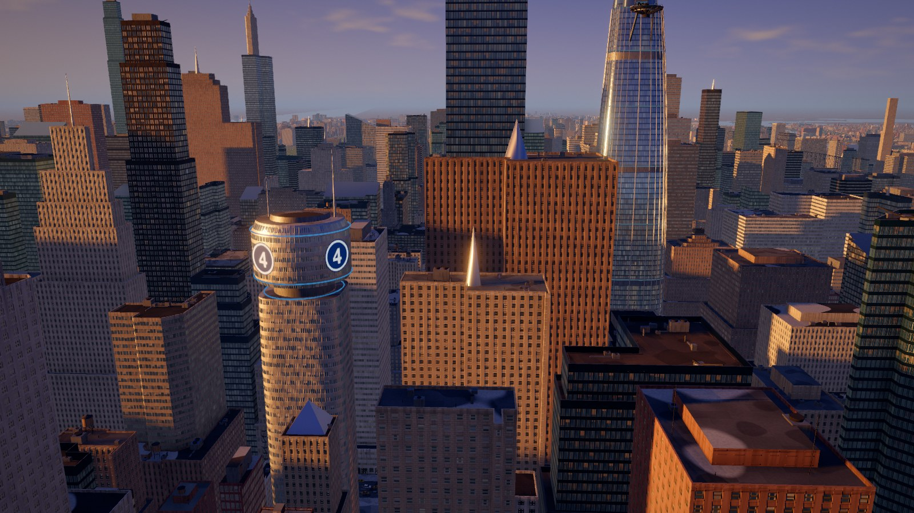

| | | |
| --- | --- | --- |
| 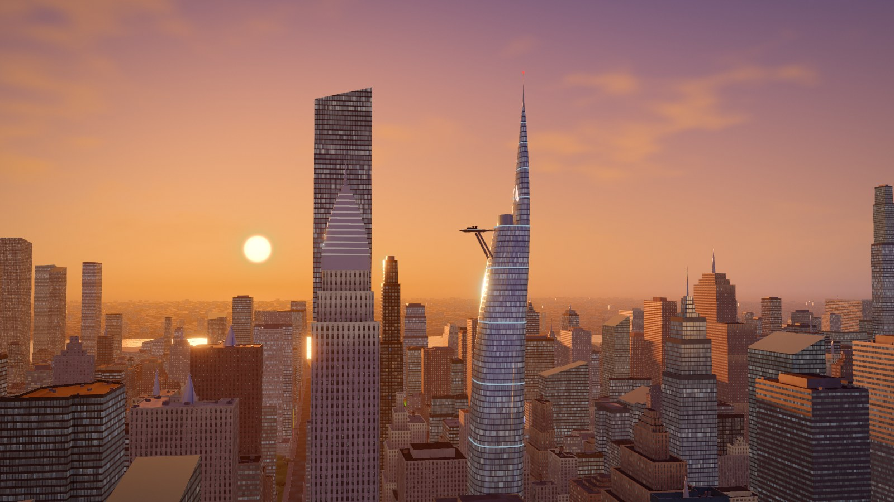 | 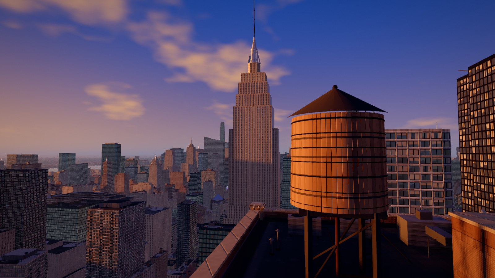 | 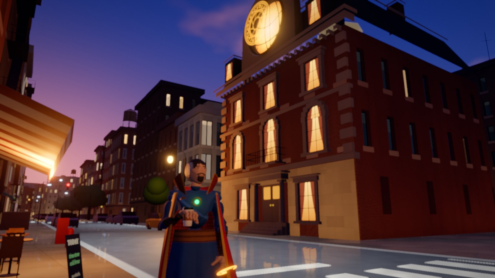 |
| 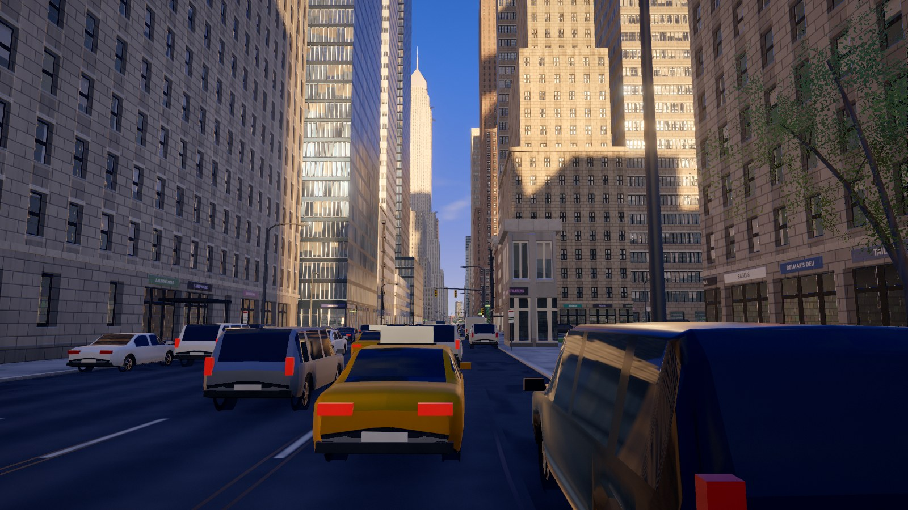 | 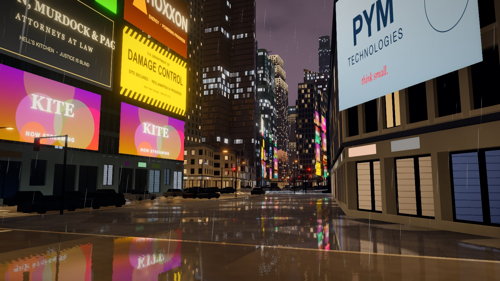 | 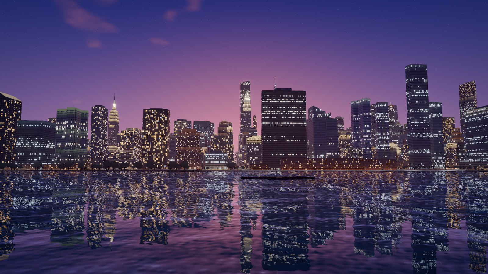 |
| 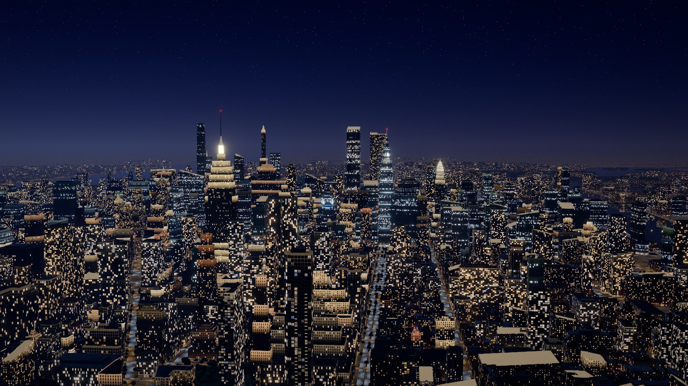 | 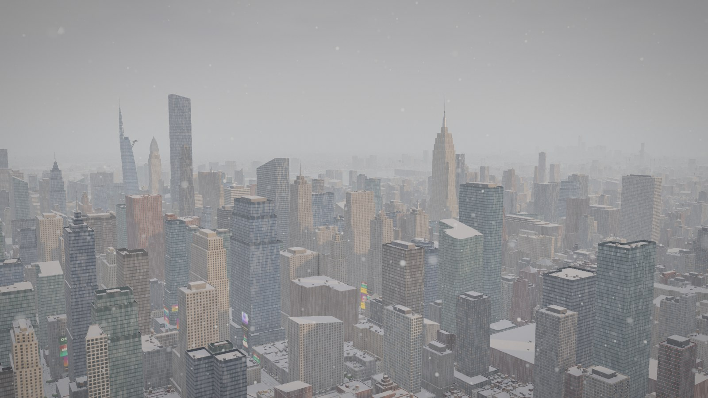 | 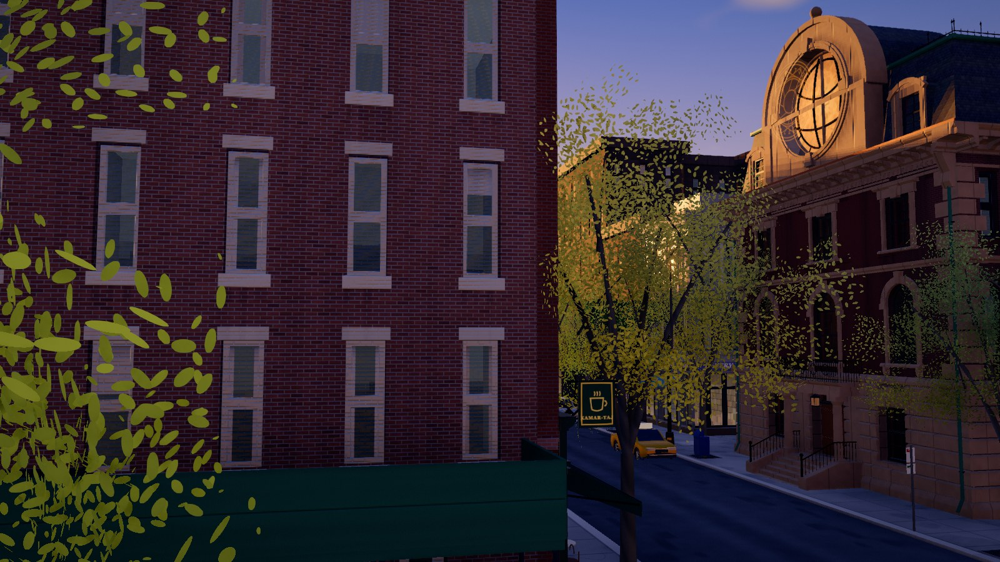 |
| 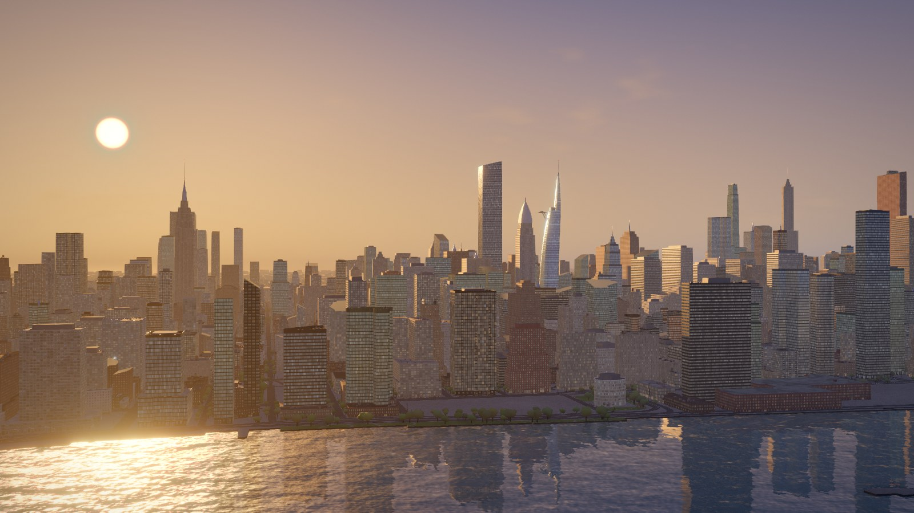 | 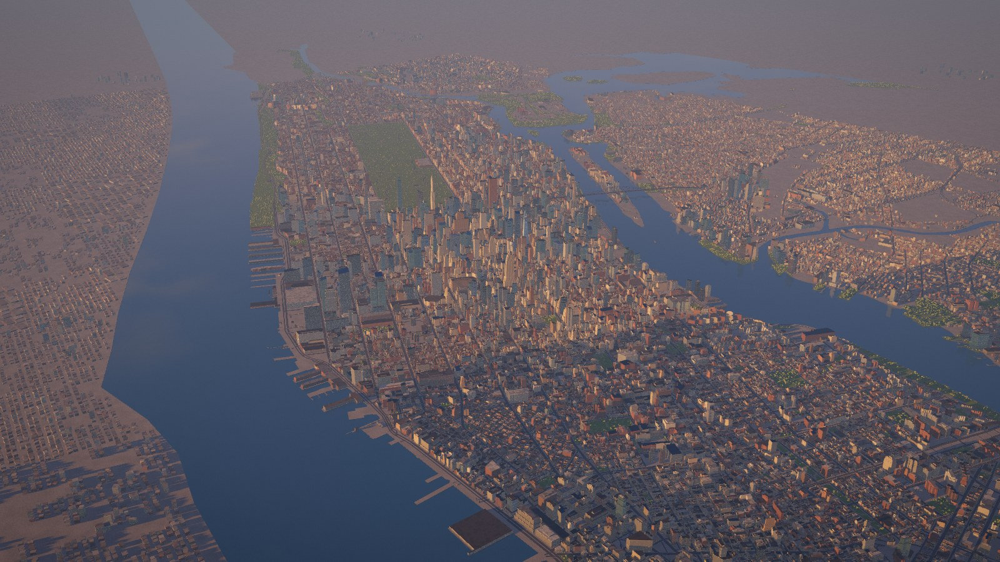 | 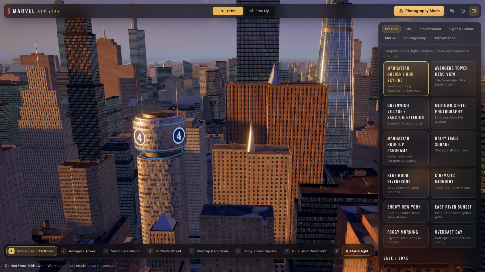 |

_All images are unretouched frames captured from the running app by `tools/shots.mjs` (1600×900, High quality, Phase 2)._

### Phase 1 → Phase 2 (same cameras)

| Phase 1 (outdated) | Phase 2 |
| --- | --- |
| 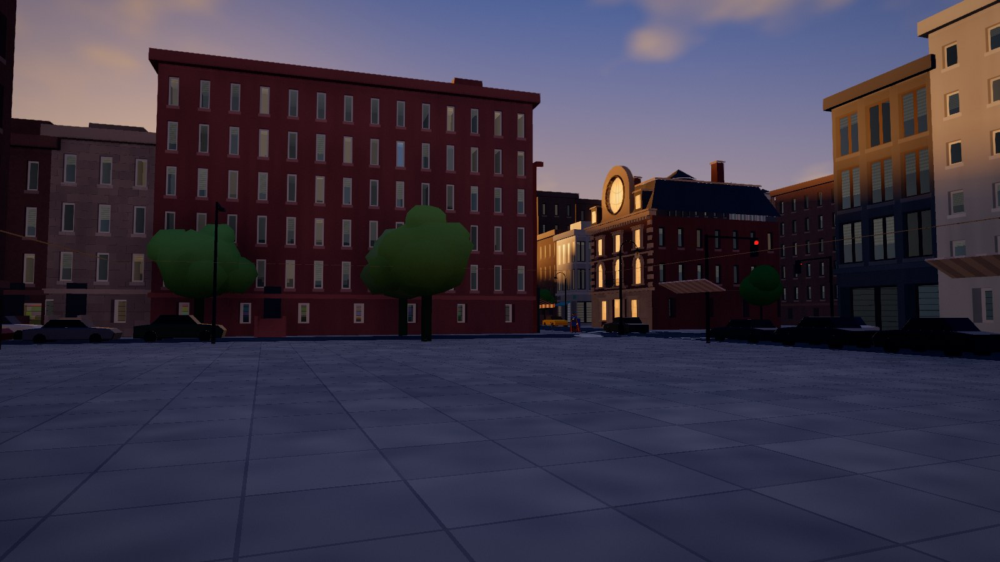 | 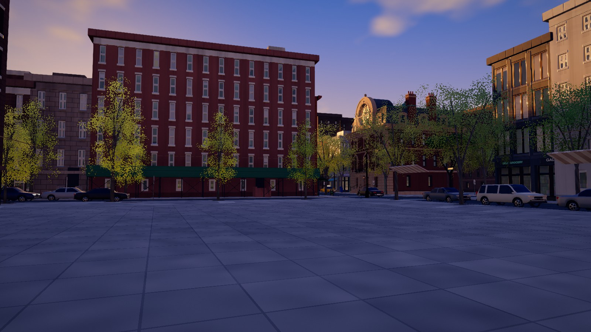 |
| 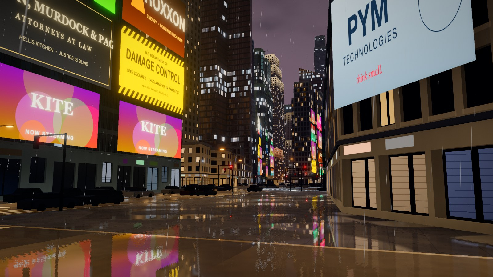 |  |
| 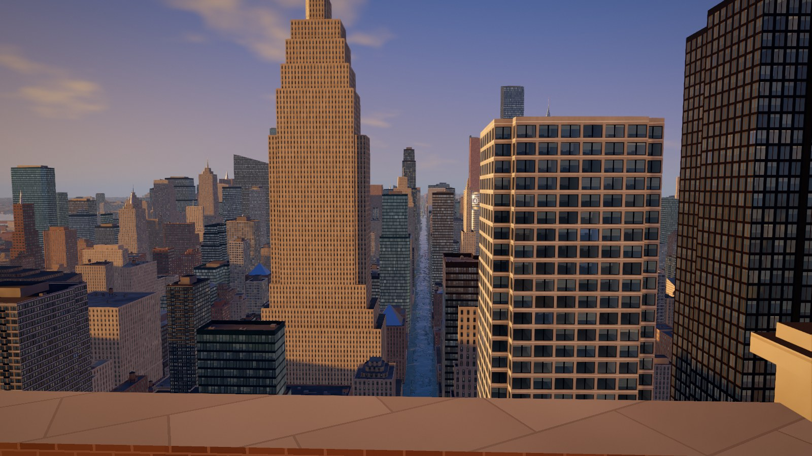 |  |

(The Times Square and rooftop cameras were re-composed in Phase 2; the village pair uses the identical camera.)

## Run it

```bash
npm install
npm run dev          # http://127.0.0.1:5173
```

| Command | Purpose |
| --- | --- |
| `npm run dev` | Development server |
| `npm run build` / `npm run preview` | Type-check + production bundle, then serve it |
| `npm test` | Unit tests (generation determinism, atmosphere, geography, presets, settings migration, export sizes) |
| `npm run typecheck` | TypeScript only |
| `npm run fetch-geo` | Re-download & re-bake the NYC Open Data layers into `public/data/` (optional; baked data is committed) |
| `npm run shots -- <shot…>` | Headless visual-validation screenshots (needs Google Chrome; dev server must be running) |
| `node tools/perf.mjs` | Frame-time probe at several bookmarks (resting and travelling camera) |

Requirements: Node 20+, a WebGL2 browser (Chrome / Edge / Safari / Firefox, desktop). Developed on Apple-silicon.

## Using it

* **Orbit** (default): left-drag rotate · right-drag / shift-drag pan · wheel zoom · double-click to set the pivot.
* **Free fly** (`F`): `W A S D` move · `Q`/`E` down/up · drag to look · `Shift` fast · wheel changes speed.
* **Bookmarks** (`1`–`9`, bottom bar): Golden Hour Midtown, Avengers Tower, Sanctum Exterior, Midtown Street, Rooftop Panorama,
  Rainy Times Square, Blue Hour Riverfront, Midtown Night, Snowy Manhattan — plus East River Sunset, Hudson Waterfront,
  High Altitude, Baxter Building and Daily Bugle. *Match light* also applies the look composed for that view.
* **Presets tab**: Manhattan Golden Hour Skyline, Avengers Tower Hero View, Greenwich Village / Sanctum Exterior,
  Midtown Street Photography, Manhattan Rooftop Panorama, Rainy Times Square, Blue Hour Riverfront, Cinematic Midnight,
  Snowy New York, East River Sunset, Foggy Morning, Overcast Day. Save / load / copy / import your own.
* **Photography Mode** (`P`): aspect masks, composition guides, lens & exposure, preview, capture (`C`). `H` hides everything.
* **Sliders**: city generation, environment, light & colour, Marvel content (landmarks, signage, magic glow), photography, performance.

Export sizes: 1080p, 1440p, 4K, 3440×1440, 5120×2160, 5K, and 8K (experimental — needs roughly 2 GB of free GPU memory).
Settings saved by Phase 1 still load: the removed character options are dropped silently and the old
"Spider-Man Rooftop" ids resolve to the Rooftop Panorama.

See `docs/progress.md` (status, verification, limitations, next steps), `docs/architecture.md` and `docs/asset-sources.md`.

This is an unofficial fan project. Marvel, Avengers and related names are trademarks of Marvel Characters, Inc.;
no Marvel artwork, models, logos or footage are included.
